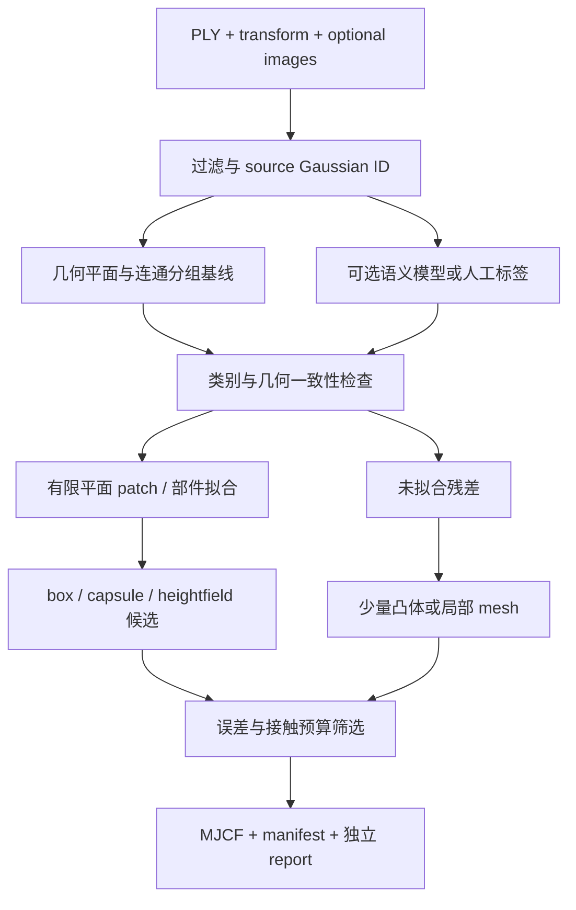

# P8 专题：从 3DGS 生成语义引导的简化碰撞

调研日期：2026-10-31。目标是将地面、墙面、台阶等结构尽量表示为少量
box/plane，并对剩余复杂区域使用有限数量的凸体。本文是文献与接口调研，
没有安装、复现或 benchmark 下述外部项目。文献事实附一手来源；路线、公式、
预算和验收设计明确属于本项目建议，不是原论文已经验证的结论。

## 1. 结论与推荐路线

推荐 **语义/结构分组 → 局部几何拟合 → 有预算的 primitive 组合 → 残差凸体**。
语义用于决定“哪类几何值得尝试”，实际尺寸、朝向、孔洞和误差必须由几何
证据约束。不能将一个 floor/wall/chair 标签直接变成整个点集的包围盒。

- 地面：有限 footprint 的厚 box 或少量共面矩形；明确无边界地面才用 plane。
- 墙面：有厚度的有限矩形 box，门窗、通道按几何证据拆开。
- 台阶：每级 tread/riser 的 box 组合，优先保留高度、边缘与支撑面。
- 桌面、柜体：先区分部件，台面/柜体可 box；不要把桌底可通行区域填实。
- 圆柱、扶手：可选 cylinder/capsule，须验证目标后端的实际碰撞开销。
- 不规则物体：先尝试少量 OBB/凸体；超出误差预算才保留局部 mesh。

本项目首版不应从零训练一个“3DGS→碰撞”的大模型，也不必先生成整个房间
的高分辨率 mesh。先做可复现的 geometry-only 基线，再增加可替换语义前端，
这样才能区分语义收益与单纯增加拟合复杂度的收益。

## 2. 现有方法究竟解决哪一段

### 2.1 语义前端：重点候选

| 方法 | 已核验的能力 | P8 用法与限制 |
|---|---|---|
| SceneSplat，ICCV 2025 | 对 Gaussian 参数进行场景理解；官方仓库支持自定义 PLY 预处理和独立特征推理 | 优先试验的 PLY-only 语义前端；仍需标签解码、几何拟合与碰撞导出 |
| Gaussian Grouping，ECCV 2024 | 用 2D SAM mask 监督 Gaussian identity，并施加 3D 一致性 | 适合已有图像/相机的分组；SAM instance ID 不自动等于 floor/wall 类别 |
| LangSplat，CVPR 2024；V2，2025 | 场景语言特征场和文本查询 | 有源图像和逐场景训练预算时考虑；不是任意普通 PLY 零训练分类器 |

SceneSplat 官方入口将自定义 PLY 转成 `coord/color/opacity/scale/quat` 数组，
再输出与 Gaussian 对齐的 `(N,768)` 特征；特征并非最终类别，需匹配分类头/
文本编码。示例中的 `excluded_classes` 包含墙/地面/天花板，P8 不可照搬。
其代码/元数据标为 CC BY-SA 4.0，数据另有来源条款；环境依赖宜隔离为离线
工具，不直接替换 mjlab 的 Torch/CUDA 依赖。
[官方仓库与自定义推理说明](https://github.com/unique1i/SceneSplat)。

Gaussian Grouping 适合作为实例/结构区域分组候选，需另做类别判定，不能把
“分割 anything”理解为已经输出可用物理形状。
[官方代码](https://github.com/lkeab/gaussian-grouping)、
[论文](https://arxiv.org/abs/2312.00732)。

LangSplat 的自定义场景流程包含图像、SfM 和语言特征优化；V2 改进了高维
特征的编码/渲染效率，但仍不是 box 碰撞生成器。文中渲染 FPS 不应作为
本项目 physics SPS 预期。
[LangSplat 官方流程](https://github.com/minghanqin/LangSplat)、
[V2 论文](https://arxiv.org/abs/2507.07136)、
[V2 代码](https://github.com/ZhaoYujie2002/LangSplatV2)。

### 2.2 平面与 primitive 重建：接近几何目标，但输入条件不同

| 方法 | 表示/输入 | 对 P8 的意义 |
|---|---|---|
| Planar Gaussian Splatting（PGS），WACV 2025 | 多视角 RGB，带平面描述和法线的 Gaussian 分组 | 借鉴平面实例分组；不是普通 PLY 的免训练后处理 |
| PlanarSplatting，CVPR 2025 | 从多视角室内图像优化显式平面 | 结构化几何参照；仍须给平面 footprint、厚度和碰撞参数 |
| GaussianBlock，ICLR 2025 | 语义引导 superquadric + Gaussian 的组合重建 | 借鉴语义一致部件、分裂/合并；不是现成 PLY→MuJoCo box 导出器 |
| SuGaR，CVPR 2024 | surface-aligned Gaussians 与 mesh 提取 | 高保真几何/残差参照；不是最小 primitive 碰撞目标 |

PGS 使用额外 plane descriptor、normal 与层次 Gaussian mixture；
PlanarSplatting 则直接优化显式平面。二者与以 mesh 重建为目标的 PGSR
不是同一个方法，论文中不要混写缩写或实验结果。
[PGS 论文](https://openaccess.thecvf.com/content/WACV2025/papers/Zanjani_Planar_Gaussian_Splatting_WACV_2025_paper.pdf)、
[PlanarSplatting 作者页](https://icetttb.github.io/PlanarSplatting/)、
[代码](https://github.com/ant-research/PlanarSplatting)。

GaussianBlock 用语义约束 superquadric 分裂/合并，并绑定 Gaussians；其论文
实验与 box 接触代理不是一回事。核验时官方 README 的第二阶段仍写着待发布，
不可将其视为完整可复用产品。
[论文](https://arxiv.org/html/2410.01535v3)、
[代码状态](https://github.com/Jiangshuyi0V0/GaussianBlock)。
SuGaR 可作为 mesh 参照；实际流程中的优化/重建条件应独立满足。
[作者页](https://imagine.enpc.fr/~guedona/sugar/)。

### 2.3 已有碰撞管线与 2026 年进展

**SAGE-3D，ICLR 2026，是重要的直接相关工作。** 它结合 object-level
语义与物理执行，但官方流程从 artist-created mesh 场景出发，使用 CoACD
分解原始 mesh，和 3DGS 配对。不能将它描述成“从任意扫描 PLY 恢复碰撞”
的已验证方案，也不能再声称语义与 Gaussian 碰撞的结合本身是全新概念。
[作者项目页及流程](https://sage-3d.github.io/)、
[论文](https://arxiv.org/abs/2510.21307)。

**SplatTransform 是应保留的 PLY-only 外部基线。** 官方工具提供体素化、
fill/carve、SVO 和 collision GLB。它不直接提供语义 box 组合；其导航 capsule
carve、填洞假设也不能原样当作双足足底接触真值。
[官方碰撞文档](https://developer.playcanvas.com/user-manual/splat-transform/collision/)、
[代码](https://github.com/playcanvas/splat-transform)。

**CoACD 是残差凸分解候选。** 输入是 mesh，输出凸部件，不能直接接受
无拓扑的 Gaussian 列表。2026-04 官方新增 metric mode，可在米制场景下
表达阈值；重建质量、solid/manifold 条件仍须检查。
[论文](https://arxiv.org/abs/2205.02961)、
[官方说明](https://github.com/SarahWeiii/CoACD)。

**VisACD，Eurographics 2026；CuACD，2026-09 预印本** 是值得跟踪的
GPU 凸分解路线。它们关注 mesh→convex 的离线生成开销，不直接解决语义
或 PLY 几何恢复，也不能由离线速度推导运行期碰撞更快。CuACD 有公开代码；
本轮未复现、未确认本机依赖/许可组合和精度。
[VisACD 作者页](https://3dlg-hcvc.github.io/visacd/)、
[CuACD 论文](https://arxiv.org/abs/2609.28731)、
[CuACD 代码](https://github.com/eliphatfs/cuacd)。

## 3. 输入条件决定首版路线

本地 room1 PLY 的 header 已检查：只有 xyz、rotation、scale、opacity 和
SH DC 字段，没有语义、实例标签或可靠表面法线；当前资产包也未提供原始
相机/训练图像入口。不能假定这些额外数据已经存在。

| 可用输入 | 建议路线 | 不能假定的条件 |
|---|---|---|
| 只有当前普通 PLY | 几何平面基线 + 手工少量标签；并行评估 SceneSplat | 普通 PLY 已含 floor/wall 标签；最小 Gaussian 轴必为表面法线 |
| PLY + 原图 + 内外参 | 图像语义分割、多视角可见性加权融合；可对照 Grouping/LangSplat | 单视角 mask 投影无误、遮挡后 Gaussian 也应获同标签 |
| 带语义 checkpoint/sidecar | 导入 per-Gaussian 类别/实例和置信度，再做几何验证 | 不同工具排序和过滤后仍天然逐行对应 |
| 有原始 mesh/CAD | 语义部件 → box/convex，SAGE/CoACD 为参照 | 这是仅从扫描 PLY 恢复未知几何的结果 |

SceneSplat `(N,768)` 特征若全部保存为 float32，以 799,083 个 Gaussian
估算约 2.45 GB（约 2.29 GiB），这是张量尺寸推算，不是实测峰值显存。
应评估分块/采样推理和只导出 label/confidence 的方案，不能承诺现有 8 GiB
显卡可直接完整推理。低置信度标签应允许 `unknown` 和人工校正。

若采用新视角渲染图做语义识别，需另行验证图像质量、可见性与深度；不能把
P6 的缺失 raw depth 当作可直接反投影的有效点。对语义融合应处理重复视角
偏置，而不是多拍同一角度就提高置信度。以上属于拟议工程设计。

## 4. 拟议的语义—几何—碰撞生成管线



以下步骤是本项目建议，尚未实现。

### 4.1 预处理与可追溯语义

1. 使用 manifest 的单位、up-axis、统一 transform；先确认重力方向，禁止
   无依据地把所有建筑强制对齐到 Manhattan world。
2. 去除非有限数据，按 opacity、尺度、连通性过滤；限制超大 Gaussian
   对拟合的支配。保存原始 `source_gaussian_id` 和原始 PLY hash。
3. 语义 sidecar 按原始 ID 关联类别、实例和置信度。opacity filter、crop、
   top-k 或重排后须同步映射，不能仅检查两数组长度相同。
4. 语义仅作类别先验：水平高平面可能是桌面，不一定是地面；wall 标签里
   可能有窗洞；同一 floor 也可能有多个高度与不连通区域。

### 4.2 几何拟合：从检测到有限 patch

Open3D 提供 RANSAC `segment_plane` 与多平面 `detect_planar_patches`；
后者输出带法线的 OBB，可作实现基线，不等于已经生成物理碰撞。
[官方点云文档](https://www.open3d.org/docs/release/tutorial/geometry/pointcloud.html#planar-patch-detection)。

建议在同语义/相邻连通区域中做鲁棒平面拟合，再投影到平面坐标 `(u,v)`，
建立支持区域与可选开口。不要对所有 wall 点一次 PCA 得到跨越门洞的大 OBB。
最小协方差轴只能在局部足够扁平且邻域一致时当法线候选，需和邻域拟合法线
对照；3DGS 的外观优化参数不保证表面几何正确。

可对照 center-only 与 covariance-aware 拟合。后者可使用投影方差，示意：

```text
Sigma_i = R_i diag(s_i^2) R_i^T
normalized_plane_residual_i = (n^T mu_i - d)^2 / (n^T Sigma_i n + epsilon)
```

该式是候选加权残差，不是碰撞概率保证。需限制巨大/高方差 splat，并报告
是否真的改善接触。Gaussian 的“3 sigma”不是可直接接受的实体边界或厚度。

### 4.3 从有限平面到 box

对法向已定为自由空间一侧的平面 patch，令平面上一点为 p，厚度为 t：

```text
box local axes = [u, v, n]
center = p - (t/2) * n
MuJoCo size = [L_u/2, L_v/2, t/2]
```

这样 box 面向自由空间的表面落在拟合平面上，避免把厚度平均分到可行走
区域而抬高地面。墙面法向/实体侧未知时，不能只凭类别猜测；需要相机可见性、
室内外约束或人工指定。厚度、几何外扩和 solver contact margin 分别记录，
避免重复膨胀。

footprint 用局部占据/支持多边形拆成少量矩形，保留门洞、坑洞、台阶边。
遮挡导致的未知区域不能自动当作开口或实体填平。候选合并必须同时满足
共面、边界误差和已知自由空间约束，而不是只最大化合并面积。

### 4.4 类别到几何的选择

| 结构 | 首选代理 | 必须保留的约束 |
|---|---|---|
| 连续有限地面 | slab box / 共面 box patch | 顶面高度；边界、坑洞和不同楼层 |
| 明确无边界的单层地面 | plane 可选 | 不能拿有限显示尺寸假装有限物理区域 |
| 墙体 | 多个薄 box | 门窗与通行宽度；厚度放在有证据的实体侧 |
| 台阶 | 每级 box 或少量组合 | tread 高度、riser、足底支撑和台阶边缘 |
| 倾斜地形 | oriented slab / heightfield | 真实坡度；heightfield 不表达悬垂/多层表面 |
| 桌/椅 | 台面与腿分部件 box/capsule | 不能用整物体外包盒填死桌底与腿间空隙 |
| 复杂残差 | OBB 组合 → 少量凸体 → 局部 mesh | 不以节省 geoms 为由封闭可通行区域 |

### 4.5 有预算的混合代理

先生成多个可行候选，再按误差—接触—计算成本选择，而不是强制全场景只用
box。拟议目标可写为：

```text
J = geometry_error + w_free * false_occupied_space
    + w_contact * support_and_edge_error + lambda * estimated_physics_cost
```

必须分别报告漏碰撞和假碰撞。增加 box 厚度可减少穿透，却可能阻塞门洞或
抬高支撑面。语义可调整各类误差权重，但权重和预算是待验证的设计，不是
来自某篇论文的既定最优配置。

## 5. MuJoCo/MJWarp 下需要纠正的简化假设

MuJoCo 官方文档建议用 primitive 替换昂贵碰撞测试，但同时应减少候选接触对。
常规 mesh geom 会按凸几何参与碰撞，因此把整个凹房间作为一个 mesh，可能
封住内部自由空间。不能将高精度视觉 mesh 的面数直接当作实际碰撞复杂度。
[官方建模/性能说明](https://mujoco.readthedocs.io/en/stable/modeling.html#performance-tuning)。

MuJoCo plane 的碰撞是无限平面，显示为有限矩形不改变这一点。有限房间
地面和墙片应优先使用 box；其 `size` 为半尺寸。
[官方 geom 说明](https://mujoco.readthedocs.io/en/stable/XMLreference.html#body-geom)。

因此，“少面数 mesh→许多 box”不保证更快：新增 geoms 会增加 broad/narrow
phase 候选对及接触约束，solver 也可能成为瓶颈。需在当前 MuJoCo/MJWarp
版本和 G1 foot/robot geom 组合上实测，不把其他引擎的结论直接套用。
更快生成 CoACD/CuACD 资产也不等于更快训练。

Gaussian 渲染继续使用原 PLY，碰撞只更换独立代理；可生成碰撞诊断图，但
不要用简化碰撞渲染的深度偷换原 3DGS 相机 observation。语义/生成模型
只在离线运行，避免把它们带入逐步 RL 训练依赖。

## 6. 建议首版交付物与实现顺序

2026-11-09 项目定位更新：主线为 3DGS 安全感知速度跟踪，要求 G1
对前方障碍减速、停车、原地旋转搜索安全方向并恢复速度跟踪，不依赖定位
或世界坐标目标。P8 首批资产优先验证有限地面、墙体、门洞及障碍的支撑与
可通行性，台阶/复杂地形作为后续接触验收；本报告的语义—几何方法和受
预算约束的生成路线不变。
具体任务协议以 TODO 第 7 节为准。

1. **P8-A，几何基线**：同一 PLY 的 center-only 点云 + 鲁棒有限平面检测，
   通过少量人工 floor/wall/step 标签校验，导出有限 box。此阶段不能叫做
   已完成自动语义识别。
2. **P8-B，语义引导**：先用 SceneSplat 小片区域验证标签质量、内存和
   source-ID 对齐；和 geometry-only 使用相同 primitive budget 对比。
   有原图后再把多视角语义融合列为独立路线。
3. **P8-C，残差处理**：保留 SplatTransform mesh 外部基线；对未拟合物体
   使用受预算控制的凸分解，优先复用 CoACD，GPU 新方法后续对照。
4. **P8-D，接触与性能**：在 synthetic ground truth 和 room1 上验证，
   通过后接 P7 的手工/自动碰撞替换对照；不修改 P7 冻结基线资产。

建议资产包包含 `collision.xml`、必要凸 mesh、`collision_report.json` 和
语义/primitive sidecar。报告记录 source hash、工具 commit/模型版本、seed、
过滤、单位/坐标、拟合容差、标签来源、box 厚度、剩余 unknown 与拒绝原因。
sidecar/report 为拟议独立文件；现有 schema v1 未定义这些扩展，不应直接
往 manifest 顶层塞未知键。现有 collision 依赖清单仍仅按加载器契约填写。

## 7. 实验矩阵与验收

| 对照 | 目的 |
|---|---|
| 手工 boxes | 可解释几何/接触参照，不当作自动方法 |
| center-only voxel / planes | 最低成本自动几何基线 |
| SplatTransform collision mesh | 已有 PLY-only 开源碰撞流程 |
| geometry-only boxes | 分离 primitive 化本身的收益 |
| semantic-guided boxes | 在相同预算下检验语义是否减少错误合并 |
| boxes + residual convex | 评价混合代理是否比全 box 保真且高效 |
| 高质量 mesh/CAD（若可得） | 几何参考，必须单独说明额外输入条件 |

先测有真值的房间、门洞、L 形墙、桌腿、楼梯、坑洞及双层地面；再测 room1。
没有外部真值的真实 PLY 只能测重投影、人工检查与任务一致性，不能把 PLY
中心或 opacity 当成绝对真值。语义错误、unknown 及少量人工修订单独统计。

预算可先扫 geoms 数 16/32/64/128、凸体顶点数和拟合容差；这是实验候选，
不是承诺能达到的场景质量。几何误差至少分高度/法线/台阶边/门洞宽度，
接触至少包括落箱、静态支撑、足部滑移/穿透及漏碰撞；不要仅用 Chamfer。

性能分别测离线生成时间/内存、headless physics SPS、启用相机后的端到端
SPS、候选接触对、实际 ncon/constraint 和显存。固定 timestep、solver、
接触参数、world 数、动作序列与相机预算，多次运行；不将可视化 FPS 当作
physics SPS。目标是在误差/接触达标约束下形成 Pareto 曲线，不预设加速倍数。

## 8. 论文定位与未决事项

已有语义 3DGS、平面重建、primitive 组合、碰撞 mesh 和凸分解，不能仅以
“语义→box”宣称首创。更值得验证的是：**有几何与自由空间约束的语义
简化，在固定接触误差/代理预算下是否改善 MuJoCo 双足接触稳定性与吞吐。**
这是待验证假设，需对 geometry-only、SplatTransform、混合代理做消融。

实施前还需确认 room1 原始图像/内外参能否获得、模型在本场景的标签质量、
可用 GPU/CPU 预算，以及 ground/wall/step 的人工验收集。首个实现应固定
小场景与出口契约，不把新语义网络训练作为启动 P8 的前置条件。

参考文献条目见 [P8 BibTeX](mjlab-3dgs-p8-references.bib)。截至本次检索，
仅对列出的论文、作者项目页和官方仓库作了核验，不声称穷尽所有最新方法。
