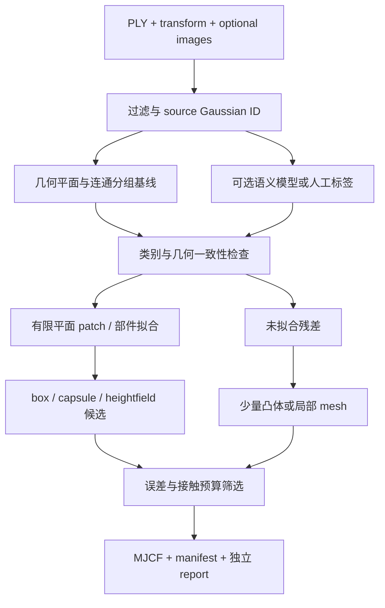

# P8 专题：从 3DGS 生成语义引导的简化碰撞

2026-11-24 当前结论：按用户明确的自动判断、不能判断则 unknown 口径，P8
工程链路和实际语义同预算 CPU/CUDA/native 对照已完成，详见
[验收记录](validation/p8-scenesplat-artanim-2026-11-24.md)。79.48% unknown
触发纯几何回退；当前语义方案未显示策略收益。独立语义准确率未测、碰撞安全
不作保证；下文较早“仍未完成”的段落保留为当时阶段记录，不是最新状态。

调研日期：2026-10-31。目标是将地面、墙面、台阶等结构尽量表示为少量
box/plane，并对剩余复杂区域使用有限数量的凸体。本文是文献与接口调研，
没有安装、复现或 benchmark 下述外部项目。文献事实附一手来源；路线、公式、
预算和验收设计明确属于本项目建议，不是原论文已经验证的结论。

2026-11-21 首轮本地实现只覆盖 mjlab 自有 primitive 基线；后续在隔离的官方
Node 22.23.5 运行时中实际复现了 SplatTransform 3.12.0 collision voxel/mesh，
并完成 multi-convex MuJoCo 转换、CPU probe 与 G1 policy 对照。后续桌面实测已
补齐同协议 CUDA policy 与 native-3DGS 联合吞吐；SplatTransform GPU 路径产物
与 llvmpipe 产物字节一致，补录的 Vulkan GPU 0 控制台显示 voxelization
0.036 s、总耗时 0.714 s、峰值 GPU 13.6 MB。``nvidia-smi`` 已归档桌面主机唯一
NVIDIA GPU 为 RTX 3060 12 GiB、driver 580.82.07；SplatTransform
``--list-gpus`` 进一步明确 adapter 0/1 为 RTX 3060、adapter 2 为 llvmpipe。
运行命令选用 ``--gpu 0``，因此该次 timing 已严格绑定 RTX 3060。

## 1. 结论与推荐路线

推荐 **语义/结构分组 → 局部几何拟合 → 有预算的 primitive 组合 → 残差凸体**。
语义用于决定“哪类几何值得尝试”，实际尺寸、朝向、孔洞和误差必须由几何
证据约束。不能将一个 floor/wall/chair 标签直接变成整个点集的包围盒。

- 地面：有限 footprint 的厚 box 或少量共面矩形；明确无边界地面才用 plane。
- 墙面：有厚度的有限矩形 box，门窗、通道按几何证据拆开。
- 台阶：每级 tread/riser 的 box 组合，优先保留高度、边缘与支撑面。
- 桌面、柜体：先区分部件，台面/柜体可 box；不要把桌底可通行区域填实。
- 圆柱、扶手：可选 cylinder/capsule，须验证目标后端的实际碰撞开销。
- 不规则物体：先尝试少量 OBB/凸体；超出误差预算才保留局部 mesh。

本项目首版不应从零训练一个“3DGS→碰撞”的大模型，也不必先生成整个房间
的高分辨率 mesh。先做可复现的 geometry-only 基线，再增加可替换语义前端，
这样才能区分语义收益与单纯增加拟合复杂度的收益。

## 2. 现有方法究竟解决哪一段

### 2.1 语义前端：重点候选

| 方法 | 已核验的能力 | P8 用法与限制 |
|---|---|---|
| SceneSplat，ICCV 2025 | 对 Gaussian 参数进行场景理解；官方仓库支持自定义 PLY 预处理和独立特征推理 | 优先试验的 PLY-only 语义前端；仍需标签解码、几何拟合与碰撞导出 |
| Gaussian Grouping，ECCV 2024 | 用 2D SAM mask 监督 Gaussian identity，并施加 3D 一致性 | 适合已有图像/相机的分组；SAM instance ID 不自动等于 floor/wall 类别 |
| LangSplat，CVPR 2024；V2，2025 | 场景语言特征场和文本查询 | 有源图像和逐场景训练预算时考虑；不是任意普通 PLY 零训练分类器 |

SceneSplat 官方入口将自定义 PLY 转成 `coord/color/opacity/scale/quat` 数组，
再输出与 Gaussian 对齐的 `(N,768)` 特征；特征并非最终类别，需匹配分类头/
文本编码。示例中的 `excluded_classes` 包含墙/地面/天花板，P8 不可照搬。
其代码/元数据标为 CC BY-SA 4.0，数据另有来源条款；环境依赖宜隔离为离线
工具，不直接替换 mjlab 的 Torch/CUDA 依赖。
[官方仓库与自定义推理说明](https://github.com/unique1i/SceneSplat)。

Gaussian Grouping 适合作为实例/结构区域分组候选，需另做类别判定，不能把
“分割 anything”理解为已经输出可用物理形状。
[官方代码](https://github.com/lkeab/gaussian-grouping)、
[论文](https://arxiv.org/abs/2312.00732)。

LangSplat 的自定义场景流程包含图像、SfM 和语言特征优化；V2 改进了高维
特征的编码/渲染效率，但仍不是 box 碰撞生成器。文中渲染 FPS 不应作为
本项目 physics SPS 预期。
[LangSplat 官方流程](https://github.com/minghanqin/LangSplat)、
[V2 论文](https://arxiv.org/abs/2507.07136)、
[V2 代码](https://github.com/ZhaoYujie2002/LangSplatV2)。

### 2.2 平面与 primitive 重建：接近几何目标，但输入条件不同

| 方法 | 表示/输入 | 对 P8 的意义 |
|---|---|---|
| Planar Gaussian Splatting（PGS），WACV 2025 | 多视角 RGB，带平面描述和法线的 Gaussian 分组 | 借鉴平面实例分组；不是普通 PLY 的免训练后处理 |
| PlanarSplatting，CVPR 2025 | 从多视角室内图像优化显式平面 | 结构化几何参照；仍须给平面 footprint、厚度和碰撞参数 |
| GaussianBlock，ICLR 2025 | 语义引导 superquadric + Gaussian 的组合重建 | 借鉴语义一致部件、分裂/合并；不是现成 PLY→MuJoCo box 导出器 |
| SuGaR，CVPR 2024 | surface-aligned Gaussians 与 mesh 提取 | 高保真几何/残差参照；不是最小 primitive 碰撞目标 |

PGS 使用额外 plane descriptor、normal 与层次 Gaussian mixture；
PlanarSplatting 则直接优化显式平面。二者与以 mesh 重建为目标的 PGSR
不是同一个方法，论文中不要混写缩写或实验结果。
[PGS 论文](https://openaccess.thecvf.com/content/WACV2025/papers/Zanjani_Planar_Gaussian_Splatting_WACV_2025_paper.pdf)、
[PlanarSplatting 作者页](https://icetttb.github.io/PlanarSplatting/)、
[代码](https://github.com/ant-research/PlanarSplatting)。

GaussianBlock 用语义约束 superquadric 分裂/合并，并绑定 Gaussians；其论文
实验与 box 接触代理不是一回事。核验时官方 README 的第二阶段仍写着待发布，
不可将其视为完整可复用产品。
[论文](https://arxiv.org/html/2410.01535v3)、
[代码状态](https://github.com/Jiangshuyi0V0/GaussianBlock)。
SuGaR 可作为 mesh 参照；实际流程中的优化/重建条件应独立满足。
[作者页](https://imagine.enpc.fr/~guedona/sugar/)。

### 2.3 已有碰撞管线与 2026 年进展

**SAGE-3D，ICLR 2026，是重要的直接相关工作。** 它结合 object-level
语义与物理执行，但官方流程从 artist-created mesh 场景出发，使用 CoACD
分解原始 mesh，和 3DGS 配对。不能将它描述成“从任意扫描 PLY 恢复碰撞”
的已验证方案，也不能再声称语义与 Gaussian 碰撞的结合本身是全新概念。
[作者项目页及流程](https://sage-3d.github.io/)、
[论文](https://arxiv.org/abs/2510.21307)。

**SplatTransform 是应保留的 PLY-only 外部基线。** 官方工具提供体素化、
fill/carve、SVO 和 collision GLB。它不直接提供语义 box 组合；其导航 capsule
carve、填洞假设也不能原样当作双足足底接触真值。
[官方碰撞文档](https://developer.playcanvas.com/user-manual/splat-transform/collision/)、
[代码](https://github.com/playcanvas/splat-transform)。

本轮将官方仓库固定到 commit ``5d5be2b1733b807a2a30a213cc677ce82a4c41ce``
（package 3.12.0），校验 Node 22.23.5 官方 Linux x64 运行时，并实际安装/运行
官方 npm 包。系统 NVIDIA driver 不可见，但 WebGPU 检测到 llvmpipe 软件 Vulkan
adapter；相同 Artanim crop、0.1 m voxel、0.1 opacity 下完成 ``faces`` 与默认
``smooth`` 两种 collision GLB。两次 voxelization 分别为 49.23/49.86 s，峰值
CPU 内存约 471/492 MB、WebGPU 内存 13.6 MB。smooth 输出为 2,227 vertices、
4,406 faces、12 components，watertight/winding-consistent 且无 boundary/
non-manifold edge；对同 crop 10,000 个输入中心的距离 mean/p95/max 为
0.1024/0.2174/0.6447 m。faces 输出为 2,764/5,222，存在 550 boundary 与 26
non-manifold edges。该对照证明官方 PLY-only voxel/collision mesh 路线已复现；
llvmpipe 时间不能外推到真实 GPU。输出仍是凹场景 triangle mesh，直接作为一个
MuJoCo mesh geom 会使用整体凸包，故须凸分解/分块后才能做公平 MuJoCo contact
benchmark；当前内部 TSDF/OBJ 也不能冒充 SplatTransform 输出。

为得到 MuJoCo 可执行外部基线，新增 GLB/OBJ→multi-convex MJCF 转换与
bundle-local mesh benchmark。对 smooth GLB 的 connected-component hull 得到
12 geoms，总凸包体积/原 mesh 体积为 1.442，source vertex→hull surface
mean/p95/max 为 0.0764/0.2570/0.3816 m；V-HACD 64-piece、resolution 200k 的
对应数值为 1.172 与 0.0287/0.0885/0.1727 m。两条路线对 manifest 的 7 个唯一
spawn XY、z=0.2/0.6/1.0 共 21 个独立 free probe 均为 0 false occupied；这组稀疏
probe 不足以证明整个室内无误占。相同 3×3 falling probes 下，component hull 为
27,456 SPS、平均 9 contacts/36 constraints/1.789 solver iterations；V-HACD 为
20,689 SPS、11.062/44.250/3.717。V-HACD 关闭 async 后两次 64-piece 输出的 MJCF
及首末 OBJ hash 一致。以上仍是单轮 CPU 小探针，不宣称统计加速；其价值是把
外部 triangle mesh 的 MuJoCo 凸碰撞语义、体积膨胀和依赖 hash 显式纳入对照。

后续 G1 tracking policy 联合评价固定 demo checkpoint/motion 和 seeds 42/43/44，
将上述几何证据与策略、接触和 policy+env 吞吐写入同一报告。平面控制 3/3 跑满
500 control steps；43 primitives、heightfield+24 residual、component hull 与
V-HACD 均只有 1/3 跑满，其余在 401--428 步触发 ``ee_body_pos``，部分同时触发
``anchor_pos``。后四者 R-MPKPE 分别约 0.0985/0.0991/0.0779/0.0789 m，均高于
平面控制的 0.0341 m。结果说明 source-surface 距离、凸体膨胀和稀疏 free probe
不能替代任务级对齐验收；CPU 单策略/三种子也不构成视觉吞吐结论。

相同输入哈希与协议的 CUDA policy 实测为 76.10--80.20 control SPS，是对应 CPU
结果的 2.88--3.49 倍；平面/内部表示成功率不变，两个 SplatTransform 表示则由
CPU 的 1/3 降至 CUDA 的 0/3，说明不能假设 CPU/CUDA 轨迹逐步等价。native 3DGS
有限时域测量的 5 个表示均完成 500 次提交且 ``gaussian_status=ready``，actual
realtime 为 0.498--0.571，viewer submission 为 24.90--28.54 SPS。该值包含 policy、
MJWarp、CPU viewer 同步与 3DGS submission，不是显示器刷新 FPS。至此 CUDA
策略/视觉测量已完成；SceneSplat 实际标签质量仍未完成。

**CoACD 是残差凸分解候选。** 输入是 mesh，输出凸部件，不能直接接受
无拓扑的 Gaussian 列表。2026-04 官方新增 metric mode，可在米制场景下
表达阈值；重建质量、solid/manifold 条件仍须检查。
[论文](https://arxiv.org/abs/2205.02961)、
[官方说明](https://github.com/SarahWeiii/CoACD)。

**VisACD，Eurographics 2026；CuACD，2026-09 预印本** 是值得跟踪的
GPU 凸分解路线。它们关注 mesh→convex 的离线生成开销，不直接解决语义
或 PLY 几何恢复，也不能由离线速度推导运行期碰撞更快。CuACD 有公开代码；
本轮未复现、未确认本机依赖/许可组合和精度。
[VisACD 作者页](https://3dlg-hcvc.github.io/visacd/)、
[CuACD 论文](https://arxiv.org/abs/2609.28731)、
[CuACD 代码](https://github.com/eliphatfs/cuacd)。

## 3. 输入条件决定首版路线

本地 room1 PLY 的 header 已检查：只有 xyz、rotation、scale、opacity 和
SH DC 字段，没有语义、实例标签或可靠表面法线；当前资产包也未提供原始
相机/训练图像入口。不能假定这些额外数据已经存在。

| 可用输入 | 建议路线 | 不能假定的条件 |
|---|---|---|
| 只有当前普通 PLY | 几何平面基线 + 手工少量标签；并行评估 SceneSplat | 普通 PLY 已含 floor/wall 标签；最小 Gaussian 轴必为表面法线 |
| PLY + 原图 + 内外参 | 图像语义分割、多视角可见性加权融合；可对照 Grouping/LangSplat | 单视角 mask 投影无误、遮挡后 Gaussian 也应获同标签 |
| 带语义 checkpoint/sidecar | 导入 per-Gaussian 类别/实例和置信度，再做几何验证 | 不同工具排序和过滤后仍天然逐行对应 |
| 有原始 mesh/CAD | 语义部件 → box/convex，SAGE/CoACD 为参照 | 这是仅从扫描 PLY 恢复未知几何的结果 |

SceneSplat `(N,768)` 特征若全部保存为 float32，以 799,083 个 Gaussian
估算约 2.45 GB（约 2.29 GiB），这是张量尺寸推算，不是实测峰值显存。
应评估分块/采样推理和只导出 label/confidence 的方案，不能承诺现有 8 GiB
显卡可直接完整推理。低置信度标签应允许 `unknown` 和人工校正。

若采用新视角渲染图做语义识别，需另行验证图像质量、可见性与深度；不能把
P6 的缺失 raw depth 当作可直接反投影的有效点。对语义融合应处理重复视角
偏置，而不是多拍同一角度就提高置信度。以上属于拟议工程设计。

## 4. 拟议的语义—几何—碰撞生成管线



以下步骤是本项目建议，尚未实现。

### 4.1 预处理与可追溯语义

1. 使用 manifest 的单位、up-axis、统一 transform；先确认重力方向，禁止
   无依据地把所有建筑强制对齐到 Manhattan world。
2. 去除非有限数据，按 opacity、尺度、连通性过滤；限制超大 Gaussian
   对拟合的支配。保存原始 `source_gaussian_id` 和原始 PLY hash。
3. 语义 sidecar 按原始 ID 关联类别、实例和置信度。opacity filter、crop、
   top-k 或重排后须同步映射，不能仅检查两数组长度相同。
4. 语义仅作类别先验：水平高平面可能是桌面，不一定是地面；wall 标签里
   可能有窗洞；同一 floor 也可能有多个高度与不连通区域。

### 4.2 几何拟合：从检测到有限 patch

Open3D 提供 RANSAC `segment_plane` 与多平面 `detect_planar_patches`；
后者输出带法线的 OBB，可作实现基线，不等于已经生成物理碰撞。
[官方点云文档](https://www.open3d.org/docs/release/tutorial/geometry/pointcloud.html#planar-patch-detection)。

建议在同语义/相邻连通区域中做鲁棒平面拟合，再投影到平面坐标 `(u,v)`，
建立支持区域与可选开口。不要对所有 wall 点一次 PCA 得到跨越门洞的大 OBB。
最小协方差轴只能在局部足够扁平且邻域一致时当法线候选，需和邻域拟合法线
对照；3DGS 的外观优化参数不保证表面几何正确。

可对照 center-only 与 covariance-aware 拟合。后者可使用投影方差，示意：

```text
Sigma_i = R_i diag(s_i^2) R_i^T
normalized_plane_residual_i = (n^T mu_i - d)^2 / (n^T Sigma_i n + epsilon)
```

该式是候选加权残差，不是碰撞概率保证。需限制巨大/高方差 splat，并报告
是否真的改善接触。Gaussian 的“3 sigma”不是可直接接受的实体边界或厚度。

### 4.3 从有限平面到 box

对法向已定为自由空间一侧的平面 patch，令平面上一点为 p，厚度为 t：

```text
box local axes = [u, v, n]
center = p - (t/2) * n
MuJoCo size = [L_u/2, L_v/2, t/2]
```

这样 box 面向自由空间的表面落在拟合平面上，避免把厚度平均分到可行走
区域而抬高地面。墙面法向/实体侧未知时，不能只凭类别猜测；需要相机可见性、
室内外约束或人工指定。厚度、几何外扩和 solver contact margin 分别记录，
避免重复膨胀。

footprint 用局部占据/支持多边形拆成少量矩形，保留门洞、坑洞、台阶边。
遮挡导致的未知区域不能自动当作开口或实体填平。候选合并必须同时满足
共面、边界误差和已知自由空间约束，而不是只最大化合并面积。

### 4.4 类别到几何的选择

| 结构 | 首选代理 | 必须保留的约束 |
|---|---|---|
| 连续有限地面 | slab box / 共面 box patch | 顶面高度；边界、坑洞和不同楼层 |
| 明确无边界的单层地面 | plane 可选 | 不能拿有限显示尺寸假装有限物理区域 |
| 墙体 | 多个薄 box | 门窗与通行宽度；厚度放在有证据的实体侧 |
| 台阶 | 每级 box 或少量组合 | tread 高度、riser、足底支撑和台阶边缘 |
| 倾斜地形 | oriented slab / heightfield | 真实坡度；heightfield 不表达悬垂/多层表面 |
| 桌/椅 | 台面与腿分部件 box/capsule | 不能用整物体外包盒填死桌底与腿间空隙 |
| 复杂残差 | OBB 组合 → 少量凸体 → 局部 mesh | 不以节省 geoms 为由封闭可通行区域 |

### 4.5 有预算的混合代理

先生成多个可行候选，再按误差—接触—计算成本选择，而不是强制全场景只用
box。拟议目标可写为：

```text
J = geometry_error + w_free * false_occupied_space
    + w_contact * support_and_edge_error + lambda * estimated_physics_cost
```

必须分别报告漏碰撞和假碰撞。增加 box 厚度可减少穿透，却可能阻塞门洞或
抬高支撑面。语义可调整各类误差权重，但权重和预算是待验证的设计，不是
来自某篇论文的既定最优配置。

## 5. MuJoCo/MJWarp 下需要纠正的简化假设

MuJoCo 官方文档建议用 primitive 替换昂贵碰撞测试，但同时应减少候选接触对。
常规 mesh geom 会按凸几何参与碰撞，因此把整个凹房间作为一个 mesh，可能
封住内部自由空间。不能将高精度视觉 mesh 的面数直接当作实际碰撞复杂度。
[官方建模/性能说明](https://mujoco.readthedocs.io/en/stable/modeling.html#performance-tuning)。

MuJoCo plane 的碰撞是无限平面，显示为有限矩形不改变这一点。有限房间
地面和墙片应优先使用 box；其 `size` 为半尺寸。
[官方 geom 说明](https://mujoco.readthedocs.io/en/stable/XMLreference.html#body-geom)。

因此，“少面数 mesh→许多 box”不保证更快：新增 geoms 会增加 broad/narrow
phase 候选对及接触约束，solver 也可能成为瓶颈。需在当前 MuJoCo/MJWarp
版本和 G1 foot/robot geom 组合上实测，不把其他引擎的结论直接套用。
更快生成 CoACD/CuACD 资产也不等于更快训练。

MuJoCo 的 SDF 是 engine plugin 接口，需要具体实现、注册与迭代梯度查询，不能
把“API 存在”当成当前 MuJoCo Warp 路径已经可用。本地 venv 未发现可直接复用
的 SDF plugin 动态库或示例，因此 P8 MVP 保留 primitive 路线，SDF 的实际实现
与接触性能比较列为需要新后端工作的研究扩展。
[官方计算说明](https://mujoco.readthedocs.io/en/stable/computation/)、
[扩展插件说明](https://mujoco.readthedocs.io/en/stable/programming/extension.html)。

Gaussian 渲染继续使用原 PLY，碰撞只更换独立代理；可生成碰撞诊断图，但
不要用简化碰撞渲染的深度偷换原 3DGS 相机 observation。语义/生成模型
只在离线运行，避免把它们带入逐步 RL 训练依赖。

## 6. 建议首版交付物与实现顺序

2026-11-09 项目定位更新：主线为 3DGS 安全感知速度跟踪，要求 G1
对前方障碍减速、停车、原地旋转搜索安全方向并恢复速度跟踪，不依赖定位
或世界坐标目标。P8 首批资产优先验证有限地面、墙体、门洞及障碍的支撑与
可通行性，台阶/复杂地形作为后续接触验收；本报告的语义—几何方法和受
预算约束的生成路线不变。
具体任务协议以 TODO 第 7 节为准。

1. **P8-A，几何基线**：同一 PLY 的 center-only 点云 + 鲁棒有限平面检测，
   通过少量人工 floor/wall/step 标签校验，导出有限 box。此阶段不能叫做
   已完成自动语义识别。
2. **P8-B，语义引导**：先用 SceneSplat 小片区域验证标签质量、内存和
   source-ID 对齐；和 geometry-only 使用相同 primitive budget 对比。
   有原图后再把多视角语义融合列为独立路线。
3. **P8-C，残差处理**：保留 SplatTransform mesh 外部基线；对未拟合物体
   使用受预算控制的凸分解，优先复用 CoACD，GPU 新方法后续对照。
4. **P8-D，接触与性能**：在 synthetic ground truth 和 room1 上验证，
   通过后接 P7 的手工/自动碰撞替换对照；不修改 P7 冻结基线资产。

建议资产包包含 `collision.xml`、必要凸 mesh、`collision_report.json` 和
语义/primitive sidecar。报告记录 source hash、工具 commit/模型版本、seed、
过滤、单位/坐标、拟合容差、标签来源、box 厚度、剩余 unknown 与拒绝原因。
sidecar/report 为拟议独立文件；现有 schema v1 未定义这些扩展，不应直接
往 manifest 顶层塞未知键。现有 collision 依赖清单仍仅按加载器契约填写。

2026-11-20 已实现 P8-A 的前两步：
``scripts/tools/generate_3dgs_collision.py`` 提供场景无关的 center-only
voxel/axis-aligned box 基线。它将全部参数、输入/输出 SHA-256、坐标假设和统计
写入独立 report，并用确定性 NPZ sidecar 保存 box 到原始 PLY vertex ID 的 CSR
映射；不修改 manifest v1。apartment 真实资产复跑得到 20,468 个占据 voxel、
89 个合并候选和 36 个保留 surface box，与现有专用原型的 surface 数一致。
新增 opt-in auto 模式在每个 merged candidate 上按 PCA 特征分类，并以归一化
表面误差验证 oriented box、sphere、cylinder 和 capsule；round fit 还必须比
oriented-box 对照降低至少 30% 误差，不通过则回退 box。
相对阈值只负责类型选择：round 绝对误差通过但相对收益不足时保留同一候选的
oriented box，并记录 rejected round 诊断，避免参数 sweep 改变碰撞覆盖。Studio
在 30%/40%/50% 阈值下均保持 190 个 primitive，cylinder 数分别为 7/4/0。
投影支持率及 gap distance 防止单个 planar fit 跨越大孔洞。Studio 首轮生成
183 box 和 7 cylinder；7 个 cylinder 相对 box 改善 33%--49%，synthetic
四类形状与方柱拒绝回归及 MuJoCo 编译通过。另增加默认关闭的 merge-stage
平面残差约束：只对 PCA 判定为近似平面的占据 voxel 候选限制到最佳拟合平面的
最大绝对距离。4 cm 阈值通过 synthetic 门洞与三阶楼梯自由空间、支撑高度和
box 预算回归；Studio 由 466/190 个 candidate/primitive 增至 554/205，其中
196 box、9 cylinder，MuJoCo 编译成功。该结果只证明通用工具可复现既有流程、
输出多 primitive 并阻止该 synthetic 楼梯过度合并；自由侧厚度锚定、桌腿/坑洞/
多层真值、Studio 人工 overlay、语义前端与接触性能仍未完成。
为下一步 Studio 人工 overlay 增加了 opt-in 类型着色输出：低透明绿色 box、
洋红 sphere、橙色 cylinder、蓝色 capsule 和低透明灰色 ground。它只改变
MJCF `rgba`，不能替代人工几何判断或接触验收。

2026-11-21 增加 opt-in known-free world-space 点 sidecar，作为 PLY-only 正占据
证据之外的显式负证据入口。merge candidate 不得包含约束 voxel，并优先选择
能隔离 free region 的切分；auto primitive 若因旋转或外扩重新侵入约束点，则
回退已验证的 axis-aligned candidate box。桌底/桌腿、3×3 坑洞及双层间隙
synthetic 回归证明约束前会被粗合并填实、约束后 probe 误占为零，并分别保持
不超过 12/6/2 个 box。sidecar 必须来自相机射线 carving、人工标注或 synthetic
truth；算法不把未观测 voxel 自动当自由空间。自动墙体实体侧推断、统一边缘
误差汇总和真实场景 sidecar 仍未完成。

同日进一步实现显式证据驱动的 planar slab 单侧锚定：仅当投影位于候选
footprint、法向距离在窗口内的 known-free 点达到配置符号一致率时，才把拟合
平面作为自由面，并把配置厚度向相反侧延伸；上下两种自由侧与双侧歧义均有
synthetic 回归。这里“实体侧”来自负证据的相反方向，不是从 PLY 或类别自动
猜测。真实场景相机射线 sidecar、跨 candidate 共面合并和统一指标仍未完成。

同日建立 opt-in covariance-aware 对照：Graphdeco scale/rotation 解码为
``R diag(scale²) Rᵀ``，其均值与 candidate center covariance 相加后做 PCA；另以
最大 Gaussian axis scale 过滤极端 splat。Artanim scale 长尾从 median 0.0228 m、
p99 0.1309 m 延伸到 max 124.8851 m。0.2 m 上限的 covariance-aware auto 得到
163 box + 9 cylinder 并可由 MuJoCo 编译。它仅证明基线可运行；是否减少几何或
接触误差必须由相同 geom 预算下的统一指标决定，不能由 primitive 数减少推断。

同日实现模型无关的 semantic sidecar 契约：原始 PLY 每个 vertex 对齐一个整数
标签，occupied voxel 用确定性多数票分配；每个标签独立 merge，并把其他标签
occupied voxel 当作不可跨越边界。unknown（默认 ``-1``）保留为 geometry-only
residual，不当作自由空间或删除；auto primitive 若外扩到其他标签 source point
则回退 AABB。输出 CSR sidecar 和 report 同步保存 primitive label。该实现提供
SceneSplat/多视角/人工标签的统一接入口，但不等于已验证任何语义模型质量。

同日增加与生成约束分离的 evaluation NPZ：独立 surface probes 统计最近 proxy
surface 的 mean/p95/max 距离，独立 free probes 统计 false-occupied 数量与比例。
生成 report 同步补齐 grid、连通分量、bounds、box 丢弃、source mapping 覆盖率
和 primitive/voxel 比，并明确 primitive-only 路线 mesh vertex/face 为 0。首版
synthetic 门洞、桌腿/桌底、三阶楼梯、坑洞和双层结构因此具有统一可执行证据；
它仍不替代真实场景人工 overlay、接触稳定性和固定预算性能比较。

P8 MVP 最终代码以输入 SHA-256 ``0451b2e2...1d361ba0`` 的 Artanim 20% PLY
重跑：center-only residual guard 生成 306 primitive，Gaussian→proxy surface
mean/p95/max 为 0.0714/0.1948/1.4517 m；0.2 m scale 上限加 covariance 生成
276 primitive，对应 0.0739/0.1998/2.9931 m，故 covariance 路线未设为默认。
统一 3×3 落球、1,000 warmup、10,000 measured step 的单轮 CPU benchmark 分别
为 20,382/20,563 steps/s，接触与约束均值近似相同。该结果建立可执行测量链路，
不把单轮约 0.9% 吞吐差异解释成可复现加速；前文 190/205/172 等数字保留为
开发中间版本历史，不应与最终 MVP 代码横向比较。

完整 P8 继续补充了表示法基线。新增纯 NumPy marching-tetrahedra TSDF 路径、
exact occupancy surface、拓扑修复/法线统一、coarse occupancy remeshing、
single-valued heightfield 与 heightfield+residual primitive。固定 Artanim crop
``[-2,-2,-0.5]--[2,2,3]``、0.1 m voxel、23,933 个 Gaussian 的单轮结果如下：

- primitive 为 43 个，输入中心到表面 mean/p95/max 为
  0.0594/0.1367/0.1809 m；
- exact occupancy mesh 为 5,653 vertices/11,752 faces，距离
  0.0437/0.0918/0.1037 m，但有 245 条 non-manifold edge，不作为可直接加载的
  单 mesh 房间碰撞；
- TSDF mesh 为 18,490 vertices/37,000 faces，boundary/non-manifold 均为 0，
  watertight/winding-consistent，距离 0.0453/0.0933/0.1157 m；
- 0.2 m coarse TSDF 为 4,878 vertices/9,720 faces，拓扑仍闭合，但距离退化为
  0.1356/0.1949/0.2240 m；
- 42×42 lowest-run heightfield 有 205 个多层/悬垂歧义列；混合表示保留 1 个
  heightfield 与 24 个 above-surface residual primitive。

表示生成时间分别为 primitive+voxel 0.168 s、occupancy mesh 0.242 s、TSDF
0.738 s、coarse TSDF 0.185 s、heightfield 0.00044 s。相同 3×3 probe、1,000
warmup、10,000 measured 的单轮 CPU 结果为 primitive 23,145 SPS、heightfield
20,772 SPS、mixed 23,692 SPS；对应平均 ncon 为 13.76/19.77/13.77。单次结果只
证明统一测量链路可运行，不支持“某表示稳定更快”的统计结论。MuJoCo 单个
user mesh 按凸包碰撞，因此上述 concave OBJ 是重建/拓扑对照，不是直接作为
整个房间单 geom 加载的方案。

固定预算接口支持 source count、semantic label weight 与 per-point importance
的确定性排序。synthetic 双层+干扰物实验在同为 2 geoms 时，geometry-only
误占层间 free probe 为 1/1，semantic-priority 为 0/1；其 surface mean 由
0.0474 m 变为 0.1260 m，明确暴露“保留通行结构会舍弃低优先级表面”的预算
权衡。2×2 probe、100 warmup、2,000 measured 的单轮 CPU SPS 分别为
94,605/96,690，接触、约束与 solver iteration 相同。该数据来自 synthetic
人工真值，只验证消融协议和诊断上界，不能替代 SceneSplat 标签质量。

2026-11-24 恢复记录：用户提供的 2026-11-22 桌面日志确认 checkpoint
393/393 keys 匹配，并生成 `(659010, 768)` 特征；但 `/tmp` 中源码、隔离环境
及特征文件现已不存在，用户确认没有备份，因此不能据此验收标签质量。
恢复工作改用被 Git 忽略的 `artifacts/p8-scenesplat/` 持久目录，checkpoint
继续只读使用 `/home/liana/SSD/Ubuntu/robot/models/` 下的原文件。
独立推理适配仅注册 PT-v3 和 LangPretrainer、使用严格权重加载，并移除
`LangPretrainer.forward` 不支持的 `return_backbone` 参数；chunk size 为 50,000。
桌面重跑后仍需核验特征、标签和固定预算对照，P8 保持进行中。
恢复验证：持久环境 PyTorch 2.5.1+cu124、spconv-cu124 2.3.8、
torch-scatter 2.1.2+pt25cu124、FlashAttention 2.7.4.post1 可导入；CPU
构建模型严格加载 393 个权重成功。官方预处理重新生成五组有限数组，均为
659,010 行；semantic feature decoder 两项定向测试通过。桌面入口为
`bash artifacts/p8-scenesplat/run-inference.sh`，输出目录为
`artifacts/p8-scenesplat/features/`，入口先检查 CUDA，避免静默回退到 CPU。
本次没有修改 mjlab runtime、play/demo 或其配置测试。
后续桌面已重新生成持久特征，CPU 检查全部有限，官方 72 类文本嵌入已实际
解码，并完成 32-geom 同预算 CPU 诊断。0.01 margin 下 79.48% 为 unknown；
没有人工标签和独立表面/自由空间真值，不能声称语义碰撞收益，完整 P8 不收口。
当前证据见 [2026-11-24 实际诊断](validation/p8-scenesplat-artanim-2026-11-24.md)。

SceneSplat 官方仓库固定在
``07e2c946203467e7dfc402832fad2b8b1e49b810``。官方 ``preprocess_gs.py`` 已在
隔离环境处理 Artanim，生成逐行对齐的 coord/color/opacity/scale/quat，均为
659,010 行且数值有限。实际语言特征/标签仍不能验收：官方
``GaussianWorld/SceneSplat_checkpoint`` 需要用户在 Hugging Face 接受条款并
登录，checkpoint 未包含在代码仓库；官方环境还依赖 CUDA 12.4、spconv、
flash-attention 和自定义 pointops。桌面 CUDA 已能运行 mjlab policy/native
viewer，但这不提供 gated checkpoint，也不等于 SceneSplat 隔离环境的这些扩展
已安装。预处理成功只证明输入契约，不证明特征、开放词汇标签或碰撞优先级质量。

为避免 checkpoint 解锁后再次改碰撞管线，新增与模型运行解耦的 feature decoder：
读取逐 Gaussian 对齐的 ``(N,D)`` SceneSplat-style features 和同空间 ``(C,D)``
class embeddings，分块归一化并按 cosine best class 解码；best similarity 或
top-two margin 不足的点保持 unknown。输出 labels、confidence/margin、class ID/name
和全量 hash。该实现只固定可审计的数据契约，不负责 SigLIP text encoding，也不
能在没有真实 feature/checkpoint 和人工标注时给出标签 precision/recall/IoU。

## 7. 实验矩阵与验收

| 对照 | 目的 |
|---|---|
| 手工 boxes | 可解释几何/接触参照，不当作自动方法 |
| center-only voxel / planes | 最低成本自动几何基线 |
| SplatTransform collision mesh | 已有 PLY-only 开源碰撞流程 |
| geometry-only boxes | 分离 primitive 化本身的收益 |
| semantic-guided boxes | 在相同预算下检验语义是否减少错误合并 |
| boxes + residual convex | 评价混合代理是否比全 box 保真且高效 |
| 高质量 mesh/CAD（若可得） | 几何参考，必须单独说明额外输入条件 |

先测有真值的房间、门洞、L 形墙、桌腿、楼梯、坑洞及双层地面；再测 room1。
没有外部真值的真实 PLY 只能测重投影、人工检查与任务一致性，不能把 PLY
中心或 opacity 当成绝对真值。语义错误、unknown 及少量人工修订单独统计。

预算可先扫 geoms 数 16/32/64/128、凸体顶点数和拟合容差；这是实验候选，
不是承诺能达到的场景质量。几何误差至少分高度/法线/台阶边/门洞宽度，
接触至少包括落箱、静态支撑、足部滑移/穿透及漏碰撞；不要仅用 Chamfer。

性能分别测离线生成时间/内存、headless physics SPS、启用相机后的端到端
SPS、候选接触对、实际 ncon/constraint 和显存。固定 timestep、solver、
接触参数、world 数、动作序列与相机预算，多次运行；不将可视化 FPS 当作
physics SPS。目标是在误差/接触达标约束下形成 Pareto 曲线，不预设加速倍数。

## 8. 论文定位与未决事项

已有语义 3DGS、平面重建、primitive 组合、碰撞 mesh 和凸分解，不能仅以
“语义→box”宣称首创。更值得验证的是：**有几何与自由空间约束的语义
简化，在固定接触误差/代理预算下是否改善 MuJoCo 双足接触稳定性与吞吐。**
这是待验证假设，需对 geometry-only、SplatTransform、混合代理做消融。

实施前还需确认 room1 原始图像/内外参能否获得、模型在本场景的标签质量、
可用 GPU/CPU 预算，以及 ground/wall/step 的人工验收集。首个实现应固定
小场景与出口契约，不把新语义网络训练作为启动 P8 的前置条件。

参考文献条目见 [P8 BibTeX](mjlab-3dgs-p8-references.bib)。截至本次检索，
仅对列出的论文、作者项目页和官方仓库作了核验，不声称穷尽所有最新方法。
